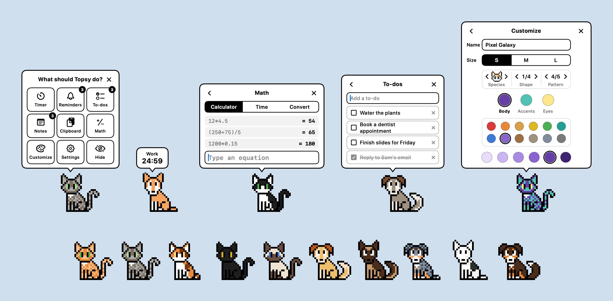

# Desktop Pet

A macOS menu bar app that puts a small pixel-art pet on your desktop. She floats above your windows, and you can drag her anywhere. Click her to open a speech bubble of little tools: a timer and Pomodoro, reminders, to-dos, notes, a clipboard history, a calculator and unit converter, a few games, and a page for customizing how she looks.



## Download

1. Download the latest `DesktopPet-….zip` from the [Releases page](https://github.com/Natalie-B-Wiese/desktop-pet/releases/latest).
2. Unzip it and drag **DesktopPet.app** into your **Applications** folder.
3. Open it. macOS will say it "can't be verified," because the app isn't notarized by Apple. Click **Done**.
4. Open **System Settings → Privacy & Security**, scroll down to the message about DesktopPet, and click **Open Anyway**. You only need to do this once.

Your pet appears on your desktop. Desktop Pet has no window or Dock icon. It lives in the menu bar, under the cat icon, where you can show or hide the pet, start timers, or quit.

Desktop Pet needs macOS 15 or later and runs on both Apple Silicon and Intel Macs.

## Using the pet

- **Click the pet** to open the menu of tools. Click her again, or click ✕, to close it.
- **Drag the pet** to move her anywhere. She remembers where you left her.
- **Right-click the pet** to hide her. Bring her back from the menu bar icon.
- **The menu bar icon** can show or hide the pet, start timers, turn on **Launch at Login**, or quit.

The main menu closes when you click somewhere else, but tool pages (Notes, Math, Clipboard and so on) stay open. That way you can look something up in another app without losing what you typed. Use ‹ to go back to the menu, or ✕ to close it.

**Clicking the speech bubble** (with the menu closed) does whatever fits what it's showing, in this order:
1. A reminder that's due: closes it. "· 2 more" means more things are waiting behind it.
2. The morning greeting: closes it.
3. A finished Pomodoro period: starts the next one (break or work).
4. "Time's up": clears it.
5. A running timer or stopwatch: pauses it, or resumes it if paused.

**Keyboard:** Esc closes the menu. The Timer, Math and add-reminder pages take the keyboard as soon as they open, so you can type right away. Other pages wait until you click a box.

## The tools

### Timer, Stopwatch and Pomodoro

Open **Timer** and pick a tab:
- **Timer** counts down. Type the minutes (or use the arrows; hold one to count quickly) and an optional label.
- **Stopwatch** counts up, with an optional label.
- **Pomodoro** alternates work and break periods. After each period it waits for you: click the bubble to start the next one.

While one runs, the bubble shows the time left. The Timer tile on the menu shows it too, and opens controls to pause, stop, rename it, or add or remove time (±30 seconds and ±5 minutes). To start a different timer, stop the current one first.

When a timer ends, the pet hops and plays the sound from **Settings → Notification**.

### Reminders

Each reminder is a time today plus an optional message and meeting link. With a link, the reminder gets a Join button that opens the call. When it comes due, the pet hops and the bubble shows it until you click it.

- **Add reminder:** type the hour, press Space, `:` or Tab, then type the minutes, and choose AM or PM. Typing works like a digital clock: the last two digits you type win. To change the hour, select it and type over it.
- With **Settings → Military time** on, there's no AM/PM and the hour goes 00–23.
- Click a reminder to edit it, or ✕ to delete it.
- **Snooze** on a reminder that came due puts it off for a few minutes (5 unless you change it in **Settings → Snooze**). Snooze again for more. The list shows "Snoozed until…" under its time. A repeating reminder keeps its usual time on the next days.
- **Pull meetings** adds reminders for today's calendar meetings. See [Google Calendar setup](#google-calendar-setup-for-reminders--pull-meetings).

### To-dos

Type a to-do and press Return. Use the ↑ ↓ arrows on the left to put them in order. Check things off as you finish them; checked ones move to the bottom. **Checked items move to the Archived tab at the end of the day**, so you don't have to clean up. Unchecked ones stay. The Archived tab lists what you finished by day, newest first; ↶ puts one back on your list. Choose how long they're kept at the top of the tab (7 days unless you change it).

### Notes

Sticky notes you type on directly. There's no Save button: everything saves as you type.
- Type on the blank **New note** at the top to start one. A new blank appears above it.
- Click a note to edit it. Return starts a new line.
- A note you empty out deletes itself when you click away, or use ✕.

### Clipboard

Keeps the last 5 things you copied anywhere on your Mac: text, images and files.
- The copy button on an item copies it again, ready to paste. The arrows on the left reorder items.
- Click an item to see it up close: all of a long text (select part of it to copy just that), a bigger image, or a color as hex, rgb, hsl and hsv, each with its own copy button. Copying one of those formats doesn't add a new item.
- New copies go on top. When the list is full, a red warning says the next copy will push out the bottom item.
- Copies that password managers mark as private aren't saved.
- A copied color like `#FF8800` shows a small swatch.
- **Take screenshot:** drag across part of the screen (or press Space to pick a window, Esc to cancel). It's copied and appears in the list.
- **Pick a color:** click anywhere on the screen, and its hex code (`#RRGGBB`) is copied.

Clipboard and screenshots need macOS permissions. See [Permissions](#permissions).

## Games

Click the pet and choose **Games**. Most of them help you make a choice; two you play with her.

- **Spinner:** a highlight runs down a list and stops on a random pick. Use ‹ › to switch lists:
  - **To-dos** picks your next to-do from the ones you haven't checked off.
  - **Coin** (heads or tails) and **RPS** (rock, paper, scissors).
  - **Custom 1, 2 and 3** are your own lists, up to 50 options each. Type on the blank row to add one. **Shuffle** mixes the list into a numbered order, like who goes first.
  - Each list remembers its last pick.
- **Number:** a random whole number between the two you type (1–100 to start).
- **Groups:** type a list of people or things, pick how many groups, and click **Make groups** to split them randomly into even groups. **Again** reshuffles.
- **Hide & Seek:** she hides in one of your open apps. Switch between your apps to find her peeking up from a window, then click her. If you don't find her in 5 minutes, she comes back on her own. Reminders and timers call her home right away. No permissions needed.
- **Words:** guess her word one letter at a time, with a category as a hint. Six wrong letters and she wins. Click the letters or type them.
- **Ask:** think of a yes-or-no question and click **Ask** for her answer, like a Magic 8-Ball.

## Chatter

Your pet can talk now and then, in a personality you pick in **Settings → Chatter**. She starts out quiet (**None**). Her speech bubble fades once you've seen it, or click it to close it right away.

- **Butler:** formal and polite, with dry wit. Fond of tea.
- **Upbeat:** excited about everything, with Gen-Z vibes.
- **Boss:** a CEO who thinks you're the star employee.
- **Sassy:** dramatic and a little full of herself.
- **Deadpan:** says odd things with a straight face.

On holidays and a few other special days she has something special to say, and from December 1 the morning greeting counts down the days until Christmas.

## Math

Click the pet and choose **Math**. The page has three tabs: **Calculator**, **Time** and **Convert**. The app remembers which tab you used last.

### Calculator

Type an equation, then press **Return** (or type `=`) to see the answer. The last 5 answers stay above the box, even after the app restarts. Click one to add its answer to the end of the box and keep going. **Esc** closes the menu.

| You type | Answer | Notes |
|---|---|---|
| `2^(3+1) * 5` | 80 | `+ - * / ^` and parentheses. `×`, `÷` and `−` work too. |
| `2(3+4)` | 14 | You can leave out `*` before parentheses. |
| `-2^2` | -4 | `^` happens before the minus sign, as in math class. |
| `ans * 2` or `_ * 2` | double the last answer | `ans` and `_` mean the newest answer in the list. |
| `80 + 20%` | 96 | Adding a percent adds that much of the number, like a tip. |
| `80 - 25%` | 60 | Subtracting a percent works like a discount. |
| `200 * 15%` | 30 | Anywhere else, `15%` just means 0.15. |
| `sqrt(9)` or `√9` | 3 | Square root, the opposite of `^2`. `2sqrt(9)` is 6. |
| `abs(-4)` | 4 | Absolute value: drops the minus sign. |
| `1,250,000 + 1` | 1,250,001 | You can type thousands commas, and answers show them. |

Some things to know:
- A comma needs exactly three digits after it, so `1,2` is an error rather than a guess.
- Clicking an answer types it back **without** commas, which is handy for pasting into code.
- `%` only means percent. There's no remainder (modulo) operator.
- Very large or very small answers show like `1.5e+20`, and that form can't be typed back in.

### Time

Adds and subtracts times, where 60 minutes make an hour. Press **Return** or type `=`, and the last 5 answers are kept, just like the Calculator.

**Lengths of time:**

| You type | Answer |
|---|---|
| `1:45 + 2:30` | 4:15 |
| `1h 30m + 90 min` | 3:00 |
| `1:30 + 45` | 2:15 (a plain number means **minutes**) |
| `1:45:30 + 45s` | 1:46:15 |
| `2d + 3h` | 51:00 |

Lengths can be `h`/`hr`/`hours`, `m`/`min`/`minutes`, `s`/`sec`/`seconds`, `d`/`days` and `w`/`weeks`, or written as `1:45` or `1:45:30`. Minutes and seconds go up to 59, so a typo like `1:75` is caught.

**Clock times** have AM or PM:

| You type | Answer |
|---|---|
| `9:30am + 2:45` | 12:15 PM |
| `11pm + 2h` | 1:00 AM +1 day |
| `5pm - 9:30am` | 7:30 (the time between them) |

Clock answers follow **Settings → Military time**. Clicking one types it back with am/pm, because that's how the Time tab knows it's a clock time.

**Dates:**

| You type | Answer |
|---|---|
| `today + 90d` | the date 90 days from today, like Sun, Jan 10, 2027 |
| `today - 2w` | the date two weeks ago |
| `Dec 25 - today` | days until Christmas, like 74 days (10w 4d) |
| `fri` | the coming Friday (today, if it's Friday) |
| `12/25/27` or `December 25, 2027` | Sat, Dec 25, 2027 |

- Dates can be `today`, `tomorrow`, `yesterday`, a weekday (`mon`, `friday`), a month and day (`Dec 25`, `December 25`), or `12/25`.
- Add a year (`Dec 25 2027`, `12/25/27`, `12/25/2027`) to pick a specific year. Without one, it picks the nearest: in October, `Jan 5` means next January, and `Oct 1` means this October.
- Add or subtract whole days and weeks: use `90d`, not `90`. A plain number means minutes, so `today + 90` is an error.
- One date minus another gives the days between them.
- Months and workdays aren't supported, and dates can't be mixed with clock times yet (`fri 5pm` doesn't work).
- Dates like `2026-12-25` don't work, because `-` means subtract.

### Convert

Pick a category, type an amount, and choose the units to convert between. The answer updates as you type. Click it to copy it. **⇅** swaps the two units, and each category remembers the units you used last.

| Category | Units |
|---|---|
| Time | sec, min, hr, day, and `h:mm` (69 min is `1:09`) |
| Length | mm, cm, m, km, in, ft, yd, mi |
| Weight | g, kg, oz, lb |
| Temperature | °C, °F, K |
| Volume | ml, L, tsp, tbsp, fl oz, cup, pt, qt, gal (US) |
| Color | hex, rgb, hsl, hsv, and 0–1 versions of each |
| Screen | px, pt (4/3 px), rem (16 px) |

- The amount can be math, like `5+2` or `1,500 * 2`.
- In `h:mm`, minutes can go past 59 (`5:70` is `6:10`), unlike the Time tab.
- **Color** takes one color at a time, pasted however you have it: `#FF8800`, `F80`, `255, 136, 0`, `rgb(255, 136, 0)` or `hsl(32, 100%, 50%)`. A line under the box shows how it was read, with a small swatch. Hex answers are uppercase, like `#FF8800`. Transparency (alpha) isn't supported yet.

## Permissions

Some features need permission from macOS. Without it they just look empty or do nothing, so check here first if something seems broken.

| Feature | Permission | Where to turn it on |
|---|---|---|
| Clipboard history | Paste from Other Apps | System Settings → Privacy & Security → **Paste from Other Apps** |
| Take screenshot | Screen Recording | System Settings → Privacy & Security → **Screen Recording** |
| Pull meetings, meeting lines in the morning greeting | Calendars | System Settings → Privacy & Security → **Calendars** (see below) |

- **Clipboard:** the first time the app reads something you copied, macOS asks whether to allow pasting. Choose **Allow**. If you denied it, the Clipboard page says so; turn on **Desktop Pet** in the setting above.
- **Screenshots:** the first time you click **Take screenshot**, macOS asks for Screen Recording and the Clipboard page shows a note. Turn on **Desktop Pet** in the setting above, then **quit and reopen the app**, because macOS only applies this permission after a restart.
- **Calendar:** see the next section.

## Google Calendar setup (for Reminders → Pull meetings)

**Pull meetings** on the Reminders page adds a reminder for each of today's remaining meetings. It reads meetings from the Mac's Calendar app, so your Google Calendar needs to be synced there first:

1. Open **System Settings → Internet Accounts**.
2. Click **Add Account…**, choose **Google**, and sign in.
3. Make sure **Calendars** is turned on for that account.
4. Open the **Calendar** app and check that your Google meetings show up. Pull meetings can only see what Calendar sees.
5. Click the pet, open **Reminders**, and click **Pull meetings**. The first time, macOS asks for Calendar access: click **Allow**.

If you clicked **Don't Allow**, click **Open Settings** on the Reminders page, or go to **System Settings → Privacy & Security → Calendars**, and turn on **Desktop Pet**.

After the first pull, Topsy pulls meetings by herself once a day: when she launches, when your Mac wakes up, or at midnight. Use the button to catch meetings added later in the day.

Each meeting's reminder goes off when the meeting starts. A few minutes before, Topsy gives you a heads-up, for meetings and your own reminders alike. Choose how early in **Settings → Early reminders** (5 minutes unless you change it), or turn it off.

Pull meetings skips all-day events, canceled meetings and ones you declined. Pulling again won't add duplicates. It updates reminders for meetings that moved or were renamed, and removes reminders for meetings that were canceled.

Meeting reminders follow your calendar, so they can't be edited in the app. Clicking one shows its details, with its meeting link and a Join button. To change one, change the meeting in Google Calendar and pull again. You can still delete one with ✕, and the next pull brings it back.

## For developers

To change the code and build the app yourself, you need:
- macOS 15 or later
- Xcode
- [XcodeGen](https://github.com/yonaskolb/XcodeGen), which you can install with `brew install xcodegen`

Then, from this folder:

```bash
./build.sh
```

The script does five things:
1. Generates `DesktopPet.xcodeproj` from `project.yml`.
2. Builds the app.
3. Quits the running copy, if there is one.
4. Installs the app to `/Applications/DesktopPet.app`.
5. Launches it.

Run it again after any change. The Xcode project is generated, so change `project.yml` instead of editing the project in Xcode.

Signing uses the development team set in `project.yml`. To build under your own Apple account, change `DEVELOPMENT_TEAM` there.

## License

[MIT](LICENSE)
